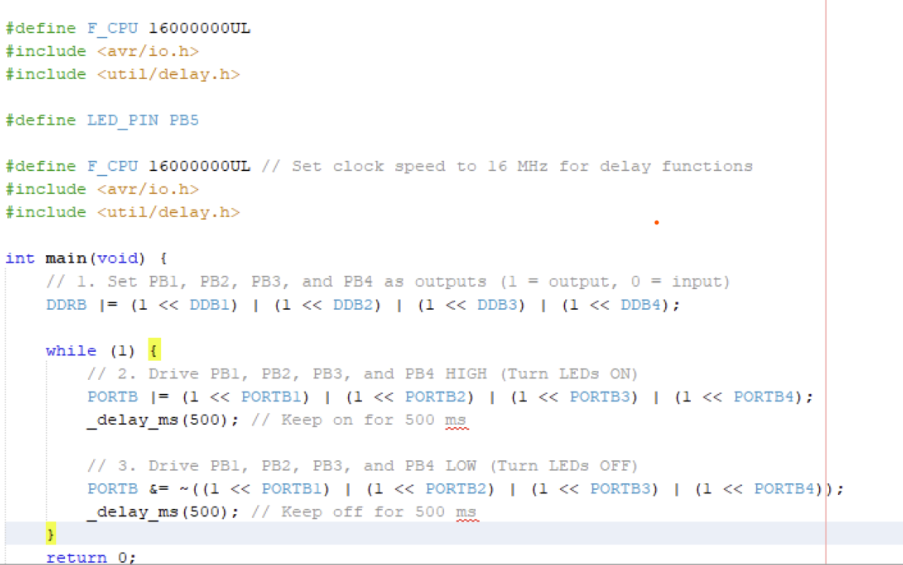
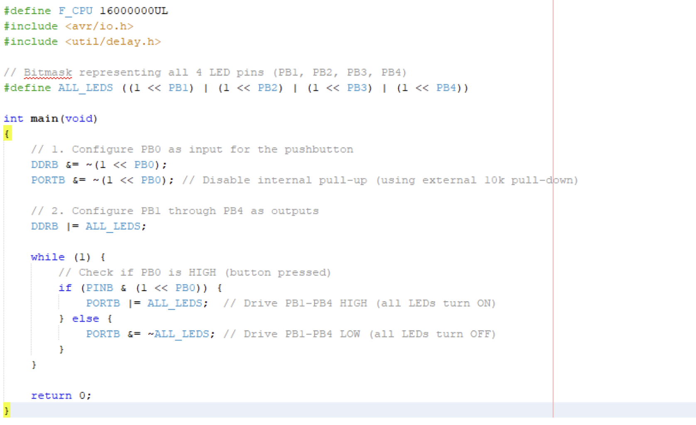
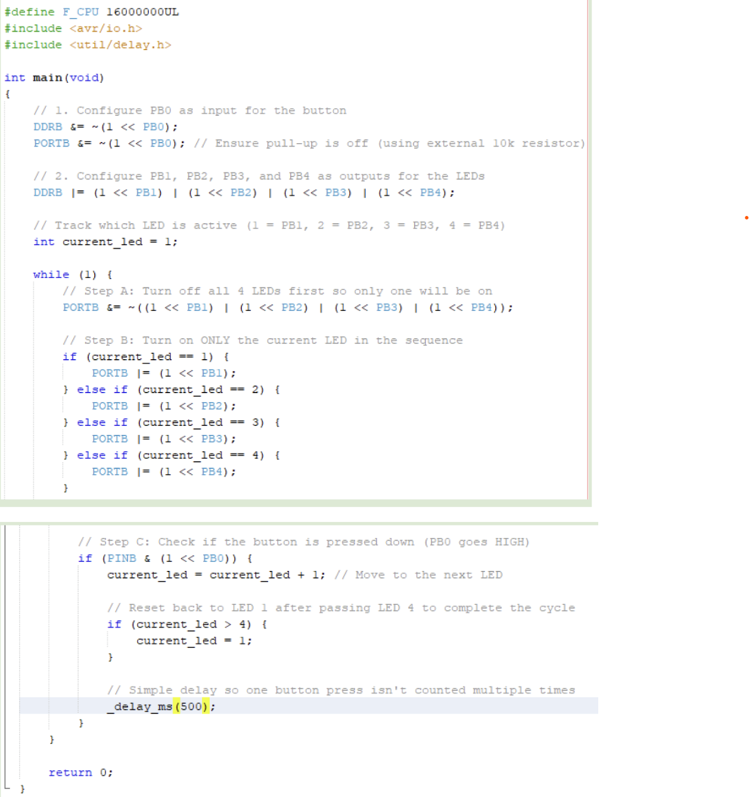
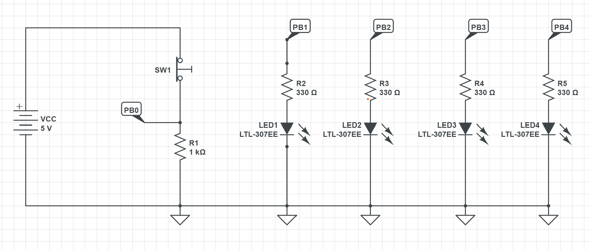
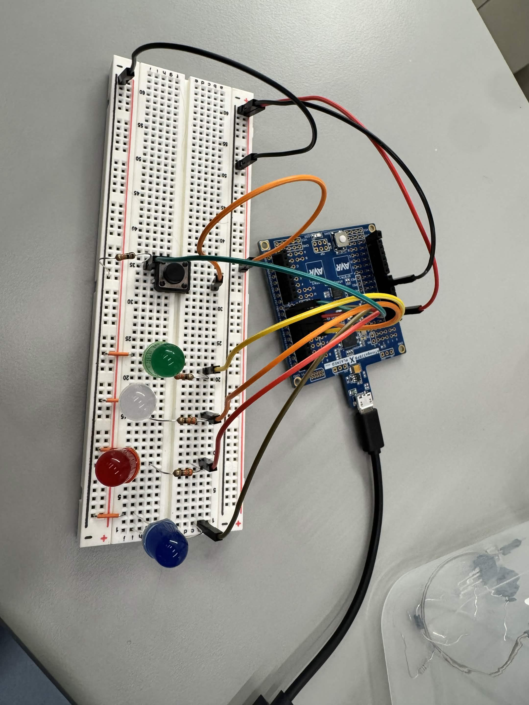
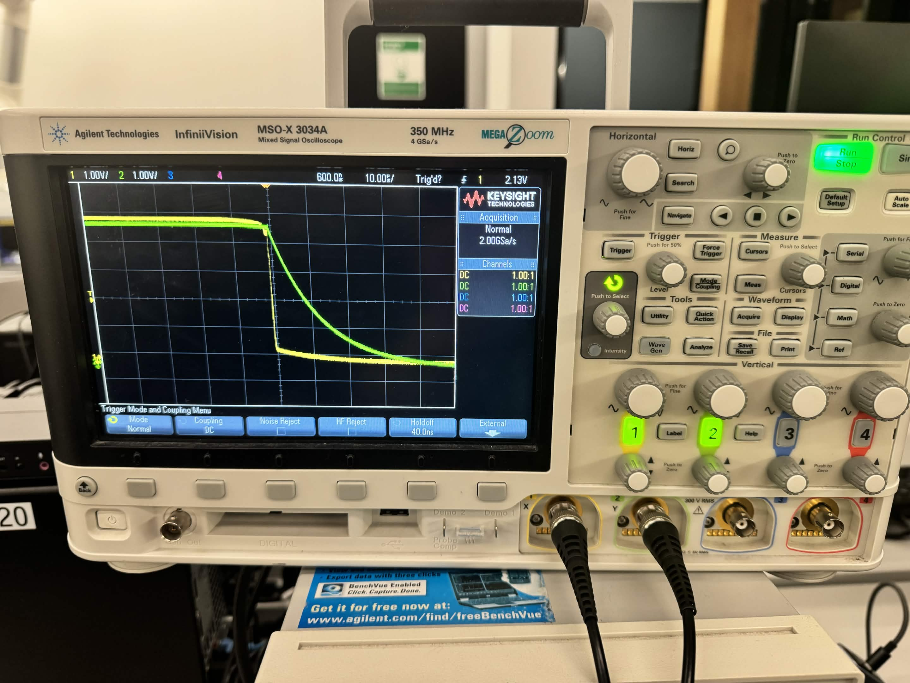
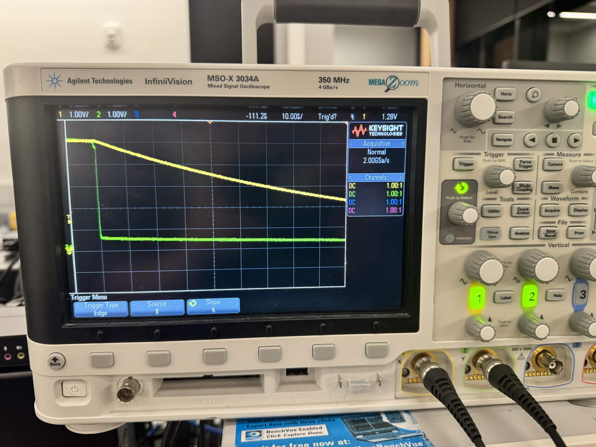

# Lab 2 Morse

**Team Name/Number: 19**

**GitHub Repository URL: https://github.com/barryli518-a11y/ese5190f26-lab2-t19.git **

| Team Member Name | Email Address       | GitHub Handle       |
|------------------|---------------------|---------------------|
| [Eric Yao]         | [yaoe@engineering.upenn.edu]           | [eric-yaoza]          |
| [Zikang Li]         | [zikangl@engineering.upenn.edu]           | [barryli518-a11y]          |

## Part A: LEDs and Pushbutton

### S1: Blinking LEDs

### S2: Button Controlled LED

### S3: Cycling LEDs

### S4: Circuit Schematic

## Part B: Interrupts

# (C1) 
The program uses Timer1 input capture interrupts on PB0. The built-in LED turns on when the button is pressed and turns off when it is released.

Code is attached in [lab2c1.c](https://github.com/barryli518-a11y/ese5190f26-lab2-t19/blob/main/lab2c1.c)

## Part C: Dash or Dot

### R1

For a 16 MHz clock:

N = f * t

50 ms: 16000000 * 0.050 = 800,000 ticks 

200 ms = 16,000,000 × 0.200 = 3,200,000 ticks

400 ms = 16,000,000 × 0.400 = 6,400,000 ticks

### R2

A prescaler divides the clock before it reaches the timer. This allows the timer to measure longer intervals before overflowing (allows us to measure much lower frequencies), but reduces timing resolution.

## Part D: Hardware Debouncing

### I1: Circuit

### I2: 1 nF Measurement

### I3: 10 nF Measurement

### R3

10 nF is more desirable for hardware debouncing because it creates a larger RC time constant than 1 nF. This smooths out the rapid voltage fluctuations caused by mechanical switch bounce, reducing the chance that one physical button press is detected as multiple presses. The tradeoff is that the signal responds more slowly, but 10 nF provides better filtering for debouncing.

## Part E: Morse Decoder

(C2): file name is [lab2c2.c](https://github.com/barryli518-a11y/ese5190f26-lab2-t19/blob/main/lab2c2.c)
## Part F: Morse Encoder

(C3) file name is [lab2c3.c](https://github.com/barryli518-a11y/ese5190f26-lab2-t19/blob/main/lab2c3.c)
